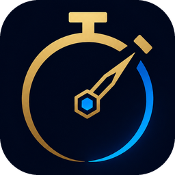
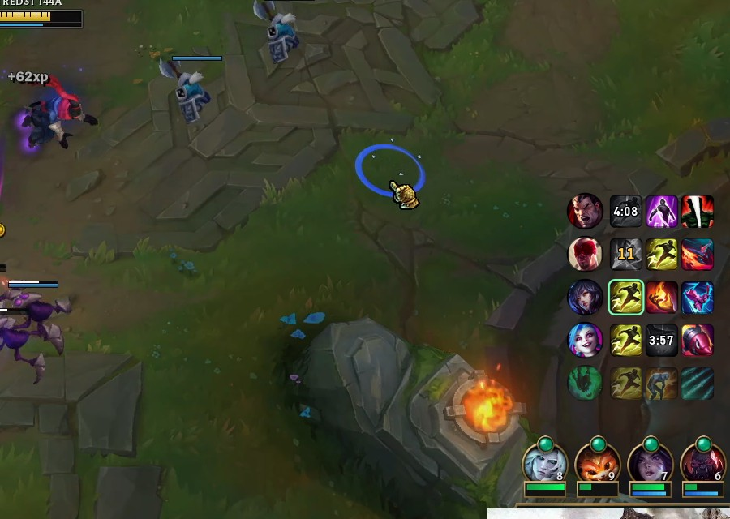

# Flashwatch

**Enemy summoner spell timers for League of Legends, with nothing to press.**
A small overlay shows the five enemies and every spell they took; when one is
used, it greys out and counts down, the way your own abilities do.

[**Download for Windows**](https://github.com/abenfraj/flashwatch/releases/latest/download/Flashwatch.exe)
· [Website](https://flashwatch.vercel.app)
· [All versions](https://github.com/abenfraj/flashwatch/releases)

<br clear="left">



## What it does

- **Times every enemy summoner spell** -- Flash, Teleport, Ignite, Heal,
  Exhaust, Barrier, Cleanse, Ghost, Smite -- and ultimates if you want them.
- **Exact cooldowns for each enemy.** Their boots, their rune trees and their
  level are taken into account: Flash is 300 s on a jungler without Inspiration
  and 254 s on a mid laner with Cosmic Insight. Unleashed Teleport follows the
  caster's level after 10:00.
- **Nothing to press, nothing to type.** When a teammate or you ping an enemy's
  spell from the scoreboard, the game writes it in chat; Flashwatch reads that
  line and starts the timer. Timers your team types (`jgl flash 950`) count too.
- **Discreet.** No box over the game: icons and numbers with their own dark edge.
  Enemies with nothing down fade out. It hides when you alt-tab, and it only
  appears in a game.
- **Only where you want it.** Summoner's Rift and the Practice Tool by default;
  ARAM, Arena and the rotating modes are off, each one a switch.
- **A sound** a few seconds before a spell is back, and when it is -- 22 voices
  to choose from, or none.
- **Four displays.** The enemy team (default), a chrono track, fixed cards or
  compact rows -- each movable anywhere, in English or French.

## Fair play

Flashwatch reads two things, both on your own machine:

1. **The chat on your screen**, with text recognition. Spell pings are lines the
   game itself prints there.
2. **The game's own data feed** -- Riot's *Live Client Data API*, served by the
   game at `127.0.0.1` for companion apps. It gives the mode, the clock, and the
   enemies' champions, spells, levels and items: exactly what the scoreboard
   (Tab) shows you.

It never injects into the game, reads its memory, touches its files or sends a
key or a click, and the only server it talks to is Riot's public Data Dragon,
for names and icons. It shows nothing you could not count yourself.

Flashwatch isn't endorsed by Riot Games and doesn't reflect the views or
opinions of Riot Games or anyone officially involved in producing or managing
Riot Games properties. Riot Games, and all associated properties, are trademarks
or registered trademarks of Riot Games, Inc.

## Install

1. [Download `Flashwatch.exe`](https://github.com/abenfraj/flashwatch/releases/latest/download/Flashwatch.exe)
   (~100 MB, Windows 10 or 11, 64-bit) and put it in a folder of its own --
   it keeps its settings in an `assets` folder next to itself.
2. Double-click it. Windows says *"Windows protected your PC"* because the file
   is not signed: **More info -> Run anyway**.
3. A short guide opens the first time. Set League to **Borderless** (Video
   settings) -- Windows does not let any overlay draw over exclusive fullscreen.

The first launch needs internet once, for the champion data and icons. It lives
in the notification area (double-click the icon for its window); tick
**Settings -> Start with Windows** and it is already running when a game begins.
It offers its own updates, and installs them when you accept.

## Using it

| | |
| --- | --- |
| **Home** | whether it is working, and the enemy team once a game is on |
| **Display** | which display, where it sits, its theme, size and opacity; *Show sample cooldowns* to try it all with League closed |
| **Settings** | language, game modes, what is tracked, sounds, start-up, updates |
| **Troubleshooting** | the self-test, the chat area, and every line the OCR read |

**To move the overlay**: *Display -> Move / resize*, drag it, press it again.
Locked, it lets every click through to the game.

**To test it without a game**: *Home -> Run the test* reads a real game frame
that ships with the program and starts the timers it finds.

## If timers do not appear

- **League in exclusive fullscreen?** Switch it to Borderless.
- **Wrong language?** *Settings -> Client language* must match your League
  client: it decides which wording is looked for in chat.
- **A mode switched off?** The home page says *Paused* in ARAM, Arena and the
  other modes until you turn them on in *Settings -> Game modes*.
- **Nobody pinged.** The game only writes a spell in chat when someone clicks
  the enemy's spell in the scoreboard (Tab). Do it yourself when you see a
  Flash and the whole team gets the timer.
- **Still nothing?** *Troubleshooting* shows every line the OCR reads; *Frame
  the chat* lets you point it at the chat by hand and watch what it sees.

## Building from source

Python 3.11 (3.13 works too).

```bash
py -3.11 -m venv .venv
```

```bash
.venv\Scripts\python -m pip install -r requirements.txt
```

```bash
run.bat
```

Each test is a standalone script that exits non-zero on failure; the release
workflow runs them all with Qt's offscreen platform:

```bash
.venv\Scripts\python tests\test_live_game.py
```

`build.py` makes the single executable (`pip install pyinstaller` first), and
pushing to `main` publishes a release on its own. How all of it works -- finding
the chat, the parser, the timers, the displays, the release pipeline -- is in
[docs/how-it-works.md](docs/how-it-works.md).

## License

[MIT](LICENSE).
